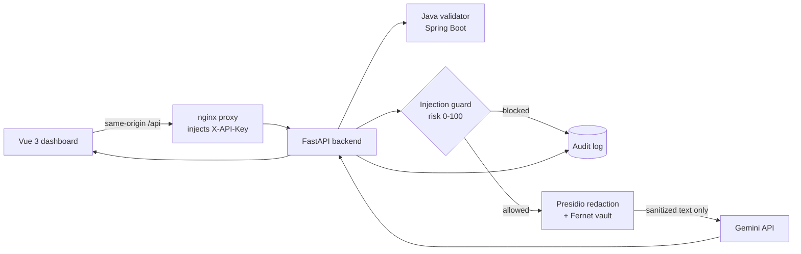
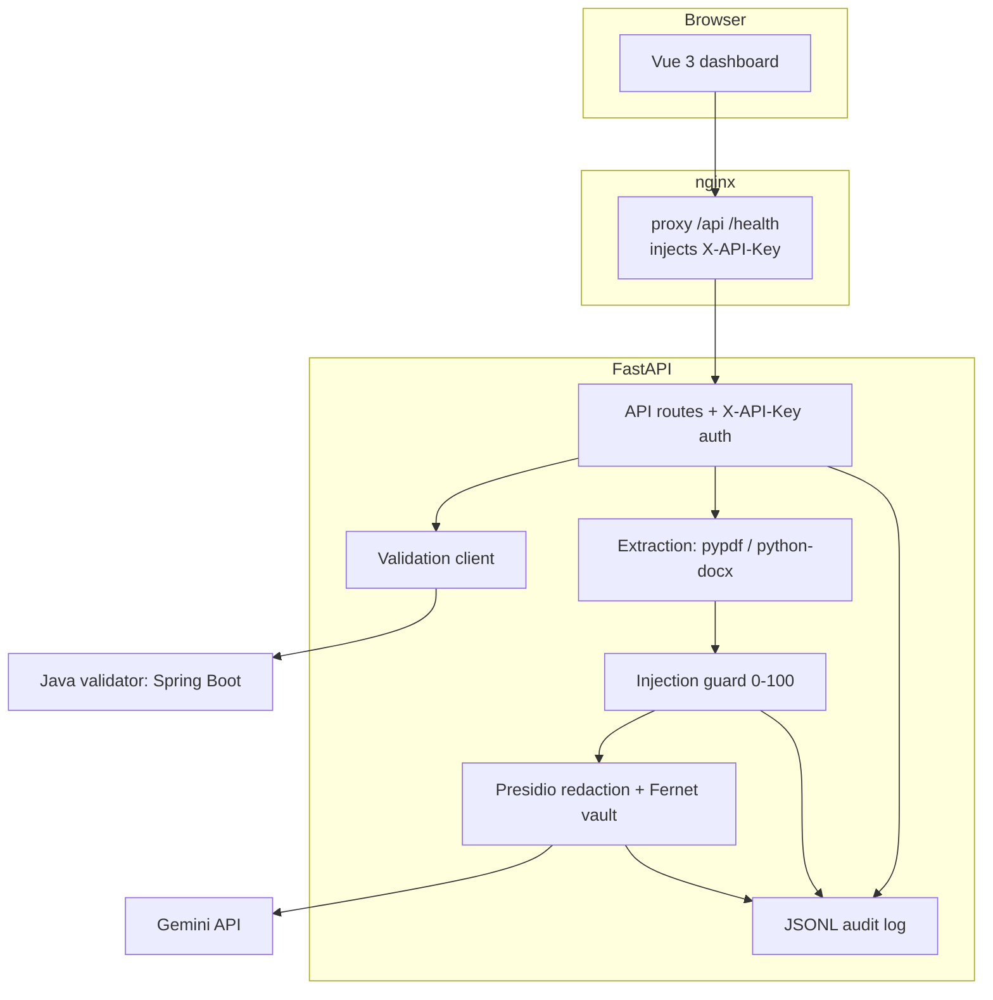

# SecureDoc AI

[](https://opensource.org/licenses/MIT)
[](https://www.python.org/)
[](https://openjdk.org/)
[](https://vuejs.org/)
[](https://fastapi.tiangolo.com/)
[](https://docs.docker.com/compose/)

**A security layer for LLM document processing.** Sensitive data is redacted and
encrypted **locally** before any text reaches an external model, prompt-injection
attempts are scored and blocked, uploads are validated by a separate Java service,
and every decision is written to an append-only audit log — aligned with GDPR
data-minimisation principles.



## Why this project

- **Defence in depth** — a metadata validator (Java), an injection guard, and PII
  redaction are independent layers; each one can reject a request.
- **Data minimisation by construction** — the model only ever sees placeholders
  such as `[PERSON_1]`; raw values never cross the process boundary.
- **Polyglot, production-shaped** — FastAPI for the pipeline, Spring Boot for the
  validation service, Vue for the UI, Docker Compose to run the whole stack.

## Features

- **Document validation microservice** — a Spring Boot service checks upload
  metadata (extension, declared content type, size, non-emptiness, path-traversal
  safety) and returns a structured result. The backend calls it before reading any
  file and **fails closed** if it is unavailable (`java-validator/`).
- **Prompt-injection defence** — a rule engine scores each request **0–100** with
  named categories, blocks at a configurable threshold, and unmasks evasion
  attempts (zero-width characters, unicode escapes, base64 payloads)
  (`services/guard_service.py`).
- **PII redaction** — Microsoft Presidio detects `PERSON`, `EMAIL_ADDRESS`,
  `PHONE_NUMBER`, `CREDIT_CARD`, `IBAN_CODE` (plus a custom German IBAN pattern);
  each entity becomes a `[PII_TYPE_<id>]` placeholder.
- **Encrypted vault** — placeholder → original mappings are stored with Fernet
  (AES-128-CBC + HMAC) and never leave the backend.
- **Upload + text extraction** — `txt`, `md`, `pdf` (pypdf), `docx` (python-docx)
  are read **in memory only**; uploads are never written to disk.
- **Audit trail** — every processed, blocked, or rejected request appends a
  metadata-only record to `data/audit.log`.
- **Security dashboard** — Vue 3 UI with a live pipeline view, blocked-request
  panel, copy buttons, and a session event feed.

## Architecture



## Project structure

```
backend/                       # FastAPI pipeline
  app/
    api/routes.py              # /process-document, /upload-document, /version
    core/config.py             # pydantic-settings
    core/auth.py               # X-API-Key dependency
    core/security.py           # Fernet key derivation
    services/guard_service.py  # injection scoring + evasion checks
    services/pii_service.py    # Presidio redaction
    services/extraction_service.py
    services/validation_service.py  # client for the Java service
    services/llm_service.py
    services/audit_service.py
  tests/                       # pytest suite
java-validator/                # Spring Boot validation microservice
  src/main/java/com/securedoc/validator/
  src/test/java/com/securedoc/validator/
frontend/                      # Vue 3 + TypeScript + Vite dashboard
docs/                          # architecture, security model, demo script
scripts/smoke-test.sh          # end-to-end curl checks
Makefile
docker-compose.yml
```

## Quick start

### Docker (whole stack)

```bash
export TOKEN_VAULT_KEY="$(openssl rand -base64 32)"
export SECUREDOC_API_KEY="$(openssl rand -hex 32)"
export GEMINI_API_KEY="your-key"        # optional
docker compose up --build
```

Frontend: `http://localhost:3000` · Backend: `http://localhost:8000` · Validator:
`http://localhost:8080`.

The browser only ever talks to **nginx** on port 3000. nginx proxies `/api` and
`/health` to the backend and injects `X-API-Key` from `SECUREDOC_API_KEY` at
request time, so the key is **never built into the frontend bundle**. Backend and
validator are bound to `127.0.0.1` for local debugging only.

**Verify the stack** (Docker daemon required):

```bash
docker compose up --build -d
curl -s http://localhost:8000/health                 # {"status":"ok",...}
open http://localhost:8000/docs                       # OpenAPI docs
open http://localhost:3000                            # dashboard
make smoke                                            # end-to-end smoke test
make audit                                            # print the audit log
docker compose down
```

`make smoke` checks health, public endpoints, the `401` on unauthenticated
requests, successful safe processing, absence of raw PII in the response, and that
an injection attempt is blocked with `400`.

### Local development

```bash
# Backend
cd backend
python3.12 -m venv .venv && ./.venv/bin/pip install -r requirements.txt
./.venv/bin/python -m spacy download en_core_web_lg
cp ../.env.example .env                # then edit values
./.venv/bin/uvicorn app.main:app --reload --port 8000

# Java validator (needs JDK 21 + Maven)
cd ../java-validator && mvn spring-boot:run

# Frontend
cd ../frontend && npm install
export SECUREDOC_API_KEY="your-key"    # dev proxy injects it server-side
npm run dev                            # http://localhost:5173
```

`GEMINI_API_KEY` is optional: without it the endpoint returns a graceful
`llm_unavailable` message after redaction, so the pipeline can be demonstrated
end-to-end without an external account.

`make help` lists every shortcut (`make backend-test`, `make java-test`,
`make frontend-build`, `make up`, `make logs`, `make smoke`, …).

## Configuration

All settings are read from the environment or `backend/.env`.

| Variable                    | Default                          | Purpose                                                     |
| --------------------------- | -------------------------------- | ----------------------------------------------------------- |
| `GEMINI_API_KEY`            | _(empty)_                        | Google Gemini API key; unset disables the LLM call.         |
| `GEMINI_MODEL`              | `gemini-2.0-flash`               | Model used for processing.                                  |
| `APP_ENV`                   | `development`                    | Environment label.                                          |
| `DATABASE_URL`              | `sqlite:///./data/securedoc.db`  | SQLite path.                                                |
| `AUDIT_LOG_PATH`            | `./data/audit.log`               | Append-only JSONL audit log.                                |
| `TOKEN_VAULT_KEY`           | _(empty)_                        | Fernet key or passphrase; **required** for redaction.       |
| `SECUREDOC_API_KEY`         | _(empty)_                        | API key for protected endpoints; **required** to serve them.|
| `INJECTION_BLOCK_THRESHOLD` | `40`                             | Risk score (0–100) at or above which a request is blocked.  |
| `JAVA_VALIDATOR_URL`        | `http://localhost:8080`          | Base URL of the validation service.                         |
| `MAX_UPLOAD_SIZE_MB`        | `5`                              | Maximum accepted document size.                             |

## API

All protected endpoints require the `X-API-Key` header.

### `POST /api/process-document`

```json
{ "text": "Email alice@example.com about IBAN DE89 3704 0044 0532 0130 00.", "task": "summarize" }
```

### `POST /api/upload-document`

`multipart/form-data` with `file` (`.txt`, `.md`, `.pdf`, `.docx`, ≤ 5 MB) and an
optional `task`. The file is validated, extracted in memory, then processed by the
same pipeline — it is never stored.

**200** — `{ task, filename, sanitized_preview, pii: { entity_count, entity_types, entities }, llm_output, audit_event_id, latency_ms }`

**400** — blocked by the guard (or rejected by the validator):

```json
{
  "message": "Request blocked by security policy",
  "reasons": ["instruction_override"],
  "categories": ["instruction_override"],
  "risk_level": "high",
  "score": 45,
  "audit_event_id": "..."
}
```

Other statuses: **401** missing/invalid key, **413** too large, **415**
unsupported/unreadable file, **503** validator unavailable.

### Other

- `GET /health` — liveness probe with version.
- `GET /api/version` — app name and version.

## Tests

```bash
cd backend && ./.venv/bin/python -m pytest -v                        # Python
cd java-validator && mvn test                                        # Java
cd frontend && npm run build                                         # type-check + build
```

The pytest suite sets its own `TOKEN_VAULT_KEY` and `SECUREDOC_API_KEY`, so no
environment setup is needed (and pre-set values would override them).

## Documentation

- [`docs/architecture.md`](docs/architecture.md) — components and request flow.
- [`docs/security-model.md`](docs/security-model.md) — threats, mitigations, limits.
- [`docs/demo-script.md`](docs/demo-script.md) — a five-minute demo walkthrough.
- [`docs/screenshot-checklist.md`](docs/screenshot-checklist.md) — shots to capture.
